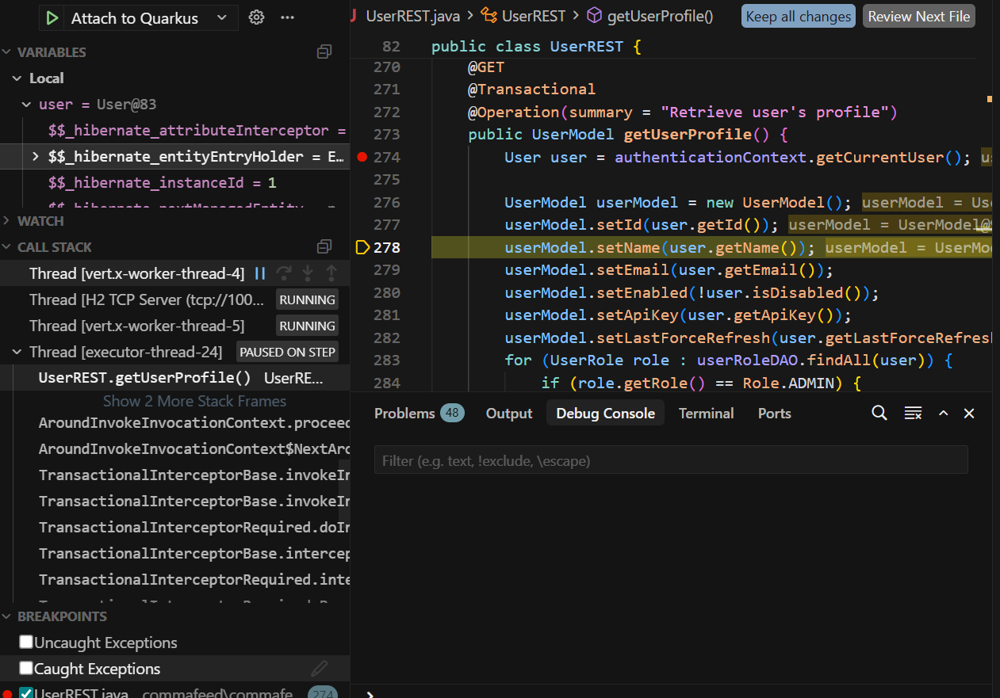

# Крок 1. Помилки початкової перевірки

Репозиторій: CommaFeed 7.3.2, коміт `fc56d5e7`, гілка `training/java-backend-fundamentals`.

## 1. `generate-code`: немає jar клієнта

### Симптом

`mvnw clean compile` і повний `mvnw compile` з кореня збирають `commafeed-client`, потім падають на `commafeed-server` ще до `javac`:

```
Failed to execute goal io.quarkus.platform:quarkus-maven-plugin:3.39.4:generate-code
Failed to inject extension deployment dependencies
at io.quarkus.bootstrap.resolver.maven.ApplicationDependencyResolver$AppDep.visitRuntimeDependency
```

Та сама команда лише для сервера проходить:

```bat
mvnw.cmd -pl commafeed-server compile
```

### Причина

Сервер залежить від клієнта як від звичайного jar:

```302:306:commafeed/commafeed-server/pom.xml
        <dependency>
            <groupId>com.commafeed</groupId>
            <artifactId>commafeed-client</artifactId>
            <version>7.3.2</version>
        </dependency>
```

У клієнта фаза `compile` лише ганяє npm (`frontend-maven-plugin`). Готовий `commafeed-client-7.3.2.jar` з'являється на фазі `package`: копія `dist` стоїть на `prepare-package`, jar пакує `maven-jar-plugin`.

Maven доводить кожен модуль реактора до запитаної фази і лише потім бере наступний. На `compile` порядок такий:

1. Клієнт закінчує `compile`. Jar ще немає.
2. У сервера стартує `generate-code`.
3. Quarkus бачить клієнта в цьому ж реакторі і намагається відкрити його jar, щоб зрозуміти, чи це Quarkus-розширення.
4. Файла немає. Виняток ховається під `Failed to inject extension deployment dependencies`.

`-pl commafeed-server` клієнта в реактор не включає. Maven бере вже встановлений артефакт:

`%USERPROFILE%\.m2\repository\com\commafeed\commafeed-client\7.3.2\commafeed-client-7.3.2.jar`

Він лежить з 13 вересня 2026 (близько 4.4 МБ). Тому окремий сервер збирається, але це стара копія фронтенду, не сьогоднішній `npm run build`.

`mvnw clean compile` цю помилку не лікує. `clean` стирає `target`, а `compile` jar клієнта так і не створює. Саме ця команда відтворює збій.

### Як зібрати

Увесь проєкт, як у README CommaFeed:

```bat
mvnw.cmd clean package
```

Клієнт спочатку доходить до `package`, jar з'являється, і лише потім сервер запускає `generate-code`.

Щоб оновити копію в `.m2`, від якої залежить `-pl commafeed-server`:

```bat
mvnw.cmd clean install
```

Після змін тільки у фронтенді, без повної перезбірки:

```bat
mvnw.cmd -pl commafeed-client install
mvnw.cmd -pl commafeed-server compile
```

## 2. `OPMLImporterTest#testOpmlV11`: ROME не приймає OPML 1.1

### Симптом

Падає лише `testOpmlV11`. Сусідні `testOpmlV10`, `testOpmlV20` і `testOpmlNoVersion` читають такі самі фікстури і мають пройти.

### Що робить тест

`testOpmlV11` читає `/opml/opml_v1.1.xml` як UTF-8 і віддає рядок у `OPMLImporter.importOpml`. `XMLCleaner` у тесті замоканий і повертає рядок без змін. Далі імпортер кличе ROME:

```40:41:commafeed/commafeed-server/src/main/java/com/commafeed/backend/opml/OPMLImporter.java
        WireFeedInput input = new WireFeedInput();
        Opml feed = (Opml) input.build(new StringReader(xml));
```

`WireFeedInput` перебирає парсери і лишає той, чий `isMyType` повернув true. У `rome-opml` 2.1.0 їх два:

- `OPML10Parser` бере корінь `opml`, якщо атрибут `version` відсутній або точно дорівнює `1.0`.
- `OPML20Parser` бере `version`, що точно дорівнює `2.0`.

У фікстурі стоїть `version="1.1"`. Обидва `isMyType` повертають false, тож `build` кидає `FeedException` / `IllegalArgumentException` ще до розбору `<outline>`. Версія 1.0 потрапляє в перший парсер, 2.0 у другий, файл без `version` теж у перший (гілка `version == null`). Тому ламається один тест.

### Чому це не CRLF

Перша гіпотеза була про перевод рядка Windows. У цьому клоні вона не сходиться:

- `.gitattributes` задає `* text eol=lf`.
- `opml_v1.0.xml`, `opml_v1.1.xml` і `opml_v2.0.xml` усі на LF, по 12 переводів рядка, включно з копіями в `target/test-classes`.
- Відрізняється лише атрибут `version`.
- `CR` і `LF` для XML допустимі. Навіть якби файл був CRLF, `XMLCleaner.removeInvalidXmlCharacters` їх не виріже, а в цьому тесті cleaner узагалі обійдений моком.

Падіння лише `testOpmlV11` відтворюється і на LF. Справа у відборі парсера ROME, не в кодуванні файлу на Windows.

## 3. `javac`: `release version 25 not supported`

Окремо від двох пунктів вище. Поки сервер збирали через `-pl commafeed-server` на JDK 21, `generate-code` уже проходив (jar клієнта брався з `.m2`), і збірка вмирала на компіляторі:

```
Compiling 148 source files with javac [debug parameters release 25]
error: release version 25 not supported
```

Батьківський `pom.xml` задає `<maven.compiler.release>25</maven.compiler.release>`. Плагін перетворює це на `javac --release 25`. JDK 21 знає релізи лише до 21, тому `Arguments.handleReleaseOptions` кидає `IllegalArgumentException` до розбору джерел.

У git це з 5 січня 2026, коміт `19663b0f` (`Java 25+ is now required`). До нього, тег `5.12.1` і старіші, стояло `--release 17`, і JDK 21 такий виклик приймав. Тег `6.0.0` і новіші, включно з 7.3.2, вимагають 25. CI теж: `JAVA_VERSION: 25`.

Перевірка, який JDK бачить саме Maven:

```bat
java -version
echo %JAVA_HOME%
mvnw.cmd -version
```

`mvnw.cmd` бере `JAVA_HOME`, якщо він заданий, і може не збігатися з `java` з `Path`. Збірка пішла на JDK 25.0.4.1. `pom.xml` під 21 не змінювався.

## 4. Відладчик на `GET /rest/user/profile`

### Як запустити

Потрібен Extension Pack for Java: з нього Debugger for Java вміє `type: "java"` у `launch.json`.

Сервер у dev mode, з каталогу `commafeed`. Цей режим сам відкриває JDWP на порту 5005:

```bat
mvnw.cmd -pl commafeed-server quarkus:dev
```

У логу має бути `Listening for transport dt_socket at address: 5005`. Конфігурація підключення лежить у `.vscode/launch.json` у корені workspace: `request` дорівнює `attach`, `port` дорівнює `5005`, `projectName` дорівнює `commafeed-server`. Сервер уже має слухати порт, і лише тоді в Run and Debug обирається **Attach to Quarkus** (F5). Attach не запускає другий процес, а чіпляється до цього.

HTTP у dev mode слухає **8083** (`%dev.quarkus.http.port` в `application.properties`). Порт 5005 лише для відладчика.

### Breakpoint

Точка стоїть у `UserREST.getUserProfile` на рядку з виконуваним кодом, не на анотації:

```java
User user = authenticationContext.getCurrentUser();
```

Це рядок 274 файлу `commafeed-server/src/main/java/com/commafeed/frontend/resource/UserREST.java`.

### Call stack у момент зупинки

З коду CommaFeed на стеку лише `UserREST.getUserProfile`. Нижче кадри фреймворку, які викликали метод і чекають повернення:

| Клас | Навіщо кадр ще на стеку |
|---|---|
| `UserREST` | поточний кадр, рядок 274 |
| перехоплювач транзакції | `@Transactional` на методі |
| перехоплювач `@RolesAllowed` | роль `USER` вже перевірена, виклик пропущений у метод |
| RESTEasy Reactive | зіставив `GET /rest/user/profile` з `getUserProfile` |
| Vert.x | прийняв HTTP на порту 8083 |

`AuthenticationContext`, `UserDAO` і `TrustedIdentityProvider` на цьому стеку відсутні: cookie вже розібрана до входу в метод. `AuthenticationContext` з’являється зверху лише після Step Into на рядку 274.

### `userModel`

Після кількох Step Over виконання доходить до `return userModel` (рядок 288). У Variables саме `userModel` є тілом відповіді клієнту. Jackson віддає його як JSON через `@Produces(APPLICATION_JSON)`.

Заповнені поля: `id`, `name`, `email`, `apiKey`, `lastForceRefresh` з сутності `user`; `enabled` як заперечення `disabled`; `admin`, якщо серед ролей є `ADMIN`. `password`, `created` і `lastLogin` метод не виставляє. Об’єкт `user` поруч містить хеш пароля і сіль, але в відповідь вони не копіюються.

### Що пояснив відладчик

Перше відкриття `http://localhost:8083/rest/user/profile` без входу дало

```json
{"message":null,"allowRegistrations":false}
```

Breakpoint на рядку 274 не спрацював. Цей JSON збирає `ExceptionMappers.unauthorized` зі статусом 401: `@RolesAllowed(Roles.USER)` не пускає аноніма в метод. `message` порожній, бо в `UnauthorizedException` немає тексту. `allowRegistrations: false` є значенням за замовчуванням, не ознакою профілю.

Після входу `demo` / `demo` у тому ж браузері cookie йде разом із запитом, виконання зупиняється на рядку 274, і клієнт отримує `userModel`, а не той об’єкт 401.

### Терміни

- **Breakpoint** зупиняє програму, коли виконання доходить до цього рядка.
- **Step Over** (F10) виконує поточний рядок цілком, разом із викликами методів, і не заходить усередину них.
- **Step Into** (F11) заходить у метод, який викликається на поточному рядку.
- **Step Out** (Shift+F11) дограє решту поточного методу і зупиняється в того, хто його викликав.

Step Into і Step Over у чернетці були поміняні місцями. Step Over не заходить у виклик. Step Into якраз заходить.

**Stack trace** є ланцюжком методів, які ще не повернулись у момент знімка: поточний кадр зверху, викликач під ним. Це не список усіх викликів за час роботи програми. Панель Call Stack показує цей ланцюжок живим. У логу помилки той самий ланцюжок друкується в момент винятку.

**Root cause** шукають у найглибшому `Caused by`, тобто в останньому такому блоці внизу логу. Перший виняток зверху є обгорткою: так `Failed to inject extension deployment dependencies` ховав справжню причину. Якщо `Caused by` немає, корінь є самим першим винятком.

